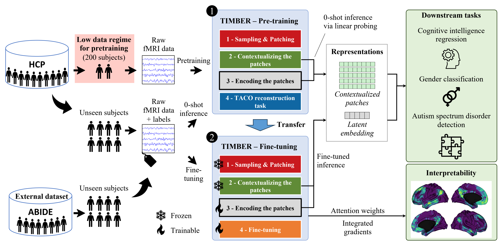
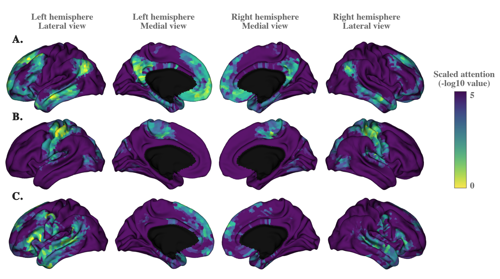

<p align="center">
  
</p>

<h1 align="center">TIMBER</h1>

<p align="center">
  <b>Time-series Embedded Representation learning</b><br>
Self-supervised representations of multichannel time series, learned from raw signals.
</p>

<p align="center">
  <a href="https://pypi.org/project/timber-ts/"></a>
  <a href="https://pypi.org/project/timber-ts/"></a>
  <a href="https://github.com/Dubris/timber-ts/blob/main/LICENSE"></a>
  <a href="https://dubris.github.io/timber-ts/"></a>
  <a href="https://hal.science/hal-05632181"></a>
</p>

---

**TIMBER** stands for *Time-series Embedded Representation learning*: the patches of a multichannel time series are embedded, and their representations are learned without labels. The paper develops the approach for cortical fMRI, where each channel is a cortical vertex, and shows that the representations are data-efficient, interpretable and transferable.

The **package is application-agnostic**. It learns from any multichannel time series given as `(time, channel)` arrays. The fMRI application and the paper experiments are in [`experiments/`](https://github.com/Dubris/timber-ts/tree/main/experiments).

## Why TIMBER

For the fMRI application of the paper:

- **Self-supervised.** Pretraining needs no labels. The TACO objective predicts each patch of a channel from the patches before it, without any predefined time-position embedding.
- **Data-efficient.** Pretraining uses **200 HCP subjects**, and the representations are competitive with supervised baselines on gender classification and cognitive score prediction.
- **Interpretable.** The attention of the encoder shows which patches each latent query reads, and integrated gradients highlight the regions behind each prediction.
- **Transferable.** The same pretrained model transfers to an external clinical dataset (ABIDE I, autism detection).
- **Atlas-free.** The model reads every channel (cortical vertex) directly, with no parcellation and no handcrafted connectivity measure.

## What the model does

1. **Sampling and patching.** Random channels and random time windows of a recording are cut into temporal patches.
2. **Contextualizing.** The contextualizer makes the patches aware of the other channels and of their past.
3. **Encoding.** The encoder summarises all the patches of an entity in a latent embedding of 512 latent queries.
4. **Task.** Pretraining decoders (TACO) learn from the patches; a head predicts a target after finetuning.

## The TACO objective

TACO (Time-Aware COnditional reconstruction) is the pretraining task of TIMBER. Its benefits:

- **No time prior.** TACO does not use a predefined time-position embedding, such as sinusoidal or rotary encodings. Such an embedding imposes a fixed assumption on the temporal structure, which can hurt the capture of brain dynamics. TACO lets the model infer the temporal relations from the data.
- **Conditioned on context.** The prediction of a patch is conditioned on the contextualized patches and on the latent embedding of the whole entity, so the model learns global structure, not only the next few samples.
- **Many training samples.** The task works on single patches. A run gives about 15,000 patch-level samples, which is why TIMBER learns from few subjects.
- **Better representations.** The paper's ablation study shows that the TACO reconstruction task improves the prediction score on cognitive intelligence regression, compared to vanilla reconstruction.

## What the model learns

TIMBER produces two representations, as in the paper:

- the **latent embedding** `e`: what the encoder returns for an entity, a compact summary of all its patches;
- the **contextualized patches** `z`: one representation per channel and per time patch, after the contextualizer.

The **latent queries** (`e_queries` in the architecture figure) are not representations. They are the learned queries of the encoder: each one reads the contextualized patches through attention. The figure below shows the attention of three latent queries over the contextualized patches. Each query attends to a different functional network, the default mode network (A), the somatomotor network (B) and language-related regions (C), and no labels were used to learn them.

<p align="center">
  
</p>

## Install

```bash
pip install timber-ts
```

The distribution is `timber-ts`, but the import name is `timber`. An unrelated PyPI project named `timber` also installs a `timber` module, so do not install both in the same environment.

Requirements: Python ≥ 3.12, PyTorch ≥ 2.15, transformers ≥ 4.51.3. CUDA, Apple MPS and CPU are supported.

## Quick start

```python
import torch
import timber  # registers TIMBER with the transformers Auto classes
from timber import TimberConfig, TimberForPretraining, TimberModel

config = TimberConfig(
    tokenizer={"num_channels": 64, "patch_length": 16},  # 64 channels, patches of 16 samples
    encoder={"num_latents": 32, "num_blocks": 2},
)
model = TimberForPretraining(config)

signal = torch.randn(4, 64, 128)  # (entity, channel, time)
output = model(signal)  # TACO loss, with 70% of the patches masked
output.loss.backward()

# Representations, without masking
model.save_pretrained("my-timber")
backbone = TimberModel.from_pretrained("my-timber").eval()
with torch.inference_mode():
    out = backbone(signal, mask_patches=False)
latent_embedding = out.last_hidden_state  # (entity, latent, latent_dim)
contextualized_patches = out.contextualized  # (entity, channel, patch, dim)
```

- **Channel subsets.** `channel_indices` (shape `(entity, channel)`) gives the index of the channel embedding of each input channel. The model has one embedding per channel of `num_channels`, and you can feed any subset of them. For example, to feed 16 random channels out of 64 for each of 4 entities:

  ```python
  signal = torch.randn(4, 16, 128)  # 16 channels per entity
  channel_indices = torch.stack([torch.randperm(64)[:16] for _ in range(4)])  # (4, 16), values in 0..63
  output = model(signal, channel_indices=channel_indices)
  ```

- **Finetuning.** Give the configuration a head and no pretraining decoder, then load the pretrained backbone with `TimberForPrediction.from_pretrained`. The [training section](#training-with-lightning) shows the full workflow.
- **Hugging Face Hub.** Models are saved in the Hugging Face format and can be loaded from the Hub with `from_pretrained`.

## Training with Lightning

Training has three steps, in this order:

1. **Data.** `TimberDataModule` turns `(time, channel)` arrays into batches and splits the entities into train, validation and test sets. A **sampler** cuts every recording into random chunks of entities, recordings, channels and time windows.
2. **Pretraining.** `TimberPretrainingModule` trains the model with the TACO objective (and any other configured decoder) on the training split.
3. **Finetuning.** `TimberFinetuningModule` trains a head on labelled entities, starting from the pretrained backbone.

The examples below follow the fMRI application of the paper, with a small model and synthetic data so that they run anywhere. Entities are subjects, recordings are runs, and channels are vertices.

**Pretraining:**

```python
from lightning.pytorch import Trainer
from timber import TimberConfig
from timber.data import TimberDataModule
from timber.device import default_precision
from timber.lightning import TimberPretrainingModule

config = TimberConfig(tokenizer={"num_channels": 64, "patch_length": 16}, encoder={"num_latents": 32, "num_blocks": 2})
files = {(f"subject-{s}", r): f"subject-{s}_run-{r}.npy" for s in range(100) for r in range(2)}  # (entity, recording) -> (time, channel) array
datamodule_config = {
    "sampler": {
        "partition_shape": [100, 2, 64, 128],        # entities, recordings, channels, time samples
        "chunk_shape": [1, 1, 32, 128],              # per chunk: one entity, one recording, 32 channels, 128 samples
        "chunks_per_batch": [4, 2, 2, 1],            # 4 entities x 2 recordings x 2 channel sets per batch
        "shuffle_before_chunking": [True, True, True, False],  # keep time windows contiguous
    },
    "num_train_entities": 80, "num_val_entities": 10, "num_test_entities": 10,
}
datamodule = TimberDataModule(datamodule_config, files)
module = TimberPretrainingModule(config, training={"learning_rate": 2e-4, "max_epochs": 30})
Trainer(max_epochs=30, precision=default_precision(), gradient_clip_val=5.0).fit(module, datamodule=datamodule)
module.export_pretrained("my-timber")  # Hugging Face folder
```

**Finetuning** from the pretrained backbone, with one label per entity:

```python
from timber import TimberConfig
from timber.data import TimberDataModule
from timber.lightning import TimberFinetuningModule

labels = {f"subject-{s}": [float(s % 2)] for s in range(100)}  # one target per entity
datamodule = TimberDataModule(datamodule_config, files, labels=labels)  # same sampler as pretraining
finetune_config = TimberConfig(  # same backbone as the pretrained model, with a head and no decoder
    tokenizer=config.tokenizer, contextualizer=config.contextualizer, encoder=config.encoder,
    decoders=[], head={"task": "regression", "num_outputs": 1}, patch_mask_ratio=0.0,
)
module = TimberFinetuningModule(finetune_config, training={"learning_rate": 2e-5, "head_learning_rate": 2e-4, "max_epochs": 20})
module.load_pretrained("my-timber")  # the pretrained backbone; discard=(...) skips parameter prefixes
module.freeze_parameters(["timber.tokenizer", "timber.contextualizer", "timber.encoder.blocks.0"])
Trainer(max_epochs=20, precision=default_precision()).fit(module, datamodule=datamodule)
```

The option lists, with tensor shapes, are in the code and in the [configuration reference](https://dubris.github.io/timber-ts/configuration/): `timber.data.SamplerConfig`, `timber.data.DataModuleConfig`, `timber.lightning.TimberTrainingConfig` and `timber.TimberConfig`.

The default precision is `bf16-mixed` on CUDA and MPS, `32-true` on CPU.

## Documentation

The full documentation (concepts of each module, the data format, usage, API and the paper's results) is at https://dubris.github.io/timber-ts/.

## Repository layout

| Path | Content |
|---|---|
| `src/timber/` | the package (models, modules, Lightning wrappers, data pipeline) |
| `tests/` | package tests (synthetic data) |
| `experiments/timber_fmri/` | fMRI application layer: file conventions, presets, training entry point, analysis |
| `experiments/<n>_*/` | paper experiments (Hydra configs, MLflow tracking); see [`experiments/README.md`](https://github.com/Dubris/timber-ts/blob/main/experiments/README.md) |
| `docs/` | the documentation site (MkDocs) |

Development setup: `uv sync --group dev --group experiment`. Build the documentation with `uv run --group docs mkdocs serve`. Run `scripts/check.sh` before committing; the release steps are in [`docs/releasing.md`](https://github.com/Dubris/timber-ts/blob/main/docs/releasing.md).

## Citation

The paper is under review. Preprint: [hal.science/hal-05632181](https://hal.science/hal-05632181).

```bibtex
@article{lebris2026timber,
  title  = {TIMBER: Data-Efficient Self-Supervised Representation Learning for fMRI Time Series},
  author = {Le Bris, Alexandre and Barbano, Carlo Alberto and Wassermann, Demian},
  note   = {Under review},
  url    = {https://hal.science/hal-05632181},
  year   = {2026}
}
```

## License

MIT, see [LICENSE](https://github.com/Dubris/timber-ts/blob/main/LICENSE).
