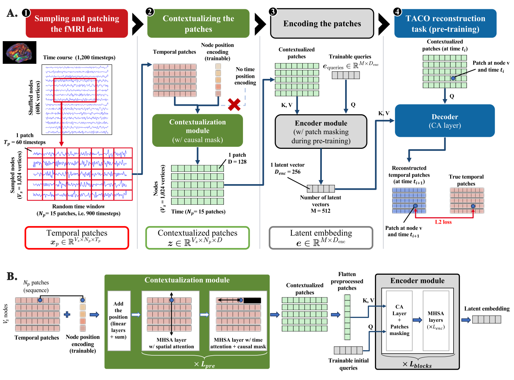

# Architecture

TIMBER turns a multichannel time series into representations in four steps. The **tokenizer** cuts the signal into
temporal patches and embeds them; the **contextualizer** gives every patch its context across channels and time; the
**encoder** summarises all the contextualized patches of an entity into a few latent embeddings; and a **task module**
uses them: pretraining decoders during pretraining, a head during finetuning. Each module is one class of the package,
and each can be resized or switched off by configuration.



*Figure: (A) the four stages; (B) the contextualization and encoder modules (paper, architecture figure).*

```text
signal (entity, channel, time)
  -> tokenizer          temporal patches x_p + channel embeddings        (entity, channel, patch, patch_length)
  -> contextualizer     contextualized patches z                          (entity, channel, patch, dim)
  -> masking            hides a fraction of the patches (pretraining only)
  -> encoder            latent queries e_queries read the patches -> latent embedding e   (entity, latent, dim)
  -> decoders (pretraining)   or   head H (finetuning, plugged after the encoder)
```

The terms follow the paper: **temporal patches** `x_p` (the raw patches), **contextualized patches** `z` (after the
contextualizer), **latent queries** `e_queries` (the learned queries of the encoder) and **latent embedding** `e` (its
output). The modules are named C (contextualizer), E (encoder), D (decoders) and H (head), as in the paper.

## Shapes

`signal` has shape `(*batch, channel, time)`. The batch axes are decomposed as follows:

- the **first** batch axis is the **entity**: the thing that carries the label (a subject, a patient, a device). The
  latent embedding and the head are computed per entity;
- the **other** batch axes are **views** of the entity, that is different samples of the same entity: recordings,
  channel chunks and time chunks. The head combines the views of an entity (see [Finetuning heads](modules/heads.md)).

A **channel chunk** is a random subset of the channels of a recording, and a **time chunk** is a window of consecutive
time points. The sampler draws them at random for every sample (see [Data pipeline](training/data.md)). This is the
paper's way of working with long recordings: the model sees many small random views of the same entity, which is cheap
to compute and makes the representation robust to the choice of channels and of the time window.

`channel` indexes the channel embeddings of the tokenizer: pass `channel_indices` to feed a subset of them.
`time` is the number of samples; it is cut into non-overlapping patches of `patch_length` samples.

## Pretraining objectives

`TimberForPretraining` runs the four steps and then the decoders listed in `config.decoders`. Three objectives are
available, each a `DecoderConfig`:

- **TACO** (`forecasting_1`, the default): the contextualized patch of each channel at time *i* predicts the patch
  that follows it, *i + 1*, of the same channel, with the latent embedding as context. It needs the **causal mask** of
  the contextualizer, so that the query cannot see the patch it predicts. TACO is what makes the contextualized patches
  informative, and it needs no explicit time-position embedding.
- **Forecasting at horizon *k*** (`forecasting_<k>`): the same task, predicting the patch *k* steps ahead. The paper
  uses *k = 1*.
- **Vanilla reconstruction** (`reconstruction`): the decoder predicts a masked patch from its position embedding (channel
  and time), without a query from the signal. This objective needs explicit time-position embeddings and a non-causal
  contextualizer. The ablation study of the paper shows that TACO gives better representations than this objective
  (see [Results](training/results.md)).

The paper also shows that adding time-position embeddings to TACO hurts the representations, so the default is TACO
without them.

Patch masking (`patch_mask_ratio`, 0.7 in the paper) happens **after the contextualizer and before the encoder**: the
contextualized patches of the masked positions are dropped, and the encoder only reads the others (see [Encoder](modules/encoder.md)).

## Finetuning

`TimberForPrediction` runs the same steps, then the head `H` is plugged **after the encoder**: it pools the latent
embedding and predicts a regression or classification target. The paper fine-tunes the encoder and the head, and keeps
the tokenizer and the contextualizer frozen (the figure of the framework shows the frozen and trainable modules). The
decoders can also be trained jointly, for example with TACO as an auxiliary objective.

## Configuration

Every module has its own dataclass, and `TimberConfig` groups them. The architecture is saved in `config.json`; the
optimisation settings are a separate object (`TimberTrainingConfig`) and are not saved with the model.

| Dataclass | Module | Main fields |
|---|---|---|
| `TokenizerConfig` | tokenizer | `patch_length`, `patch_stride`, `num_channels`, `channel_embedding_dim` |
| `ContextualizerConfig` | contextualizer | `hidden_dim`, `num_layers`, `num_heads`, `attention_order`, `is_causal` |
| `EncoderConfig` | encoder | `num_latents`, `latent_dim`, `num_blocks`, `num_self_attention_layers`, `use_cls_token` |
| `DecoderConfig` | decoders | `objective`, `loss_weight` |
| `HeadConfig` | head | `task`, `num_outputs`, `pooling`, `fusion_stage` |

The [configuration reference](configuration.md) lists every field and its default. The defaults give the architecture of
the experiments, except for the patch length (16 by default, 60 in the experiments) and the number of channels (set to
the cortex size of the fMRI data).
