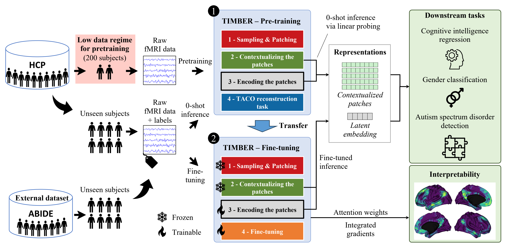
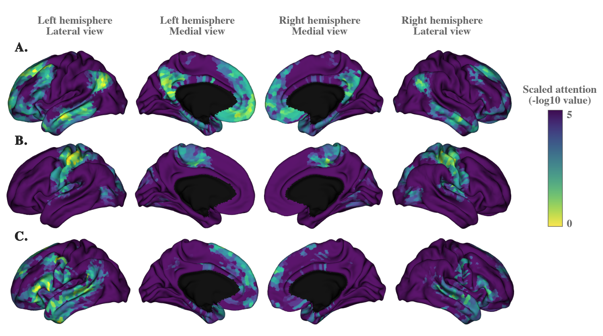

# TIMBER

**TIMBER** stands for *Time-series Embedded Representation learning*: the patches of a multichannel time series are embedded, and their representations are learned without labels. The paper develops the approach for cortical fMRI, where each channel is a cortical vertex, and shows that the representations are data-efficient, interpretable and transferable.

The **package is application-agnostic**. It learns from any multichannel time series given as `(time, channel)` arrays. The fMRI application and the paper experiments are in [`experiments/`](experiments.md).



*Figure: the framework of the paper. Pretraining (1) samples and patches the recordings, contextualizes the patches, encodes them and learns with the TACO task; fine-tuning (2) adds a head after the encoder.*

## Why TIMBER

For the fMRI application of the paper:

- **Self-supervised.** Pretraining needs no labels. The TACO objective predicts each patch of a channel from the patches before it, without any predefined time-position embedding.
- **Data-efficient.** Pretraining uses **200 HCP subjects**, and the representations are competitive with supervised baselines on gender classification and cognitive score prediction.
- **Interpretable.** The attention of the encoder shows which patches each latent query reads, and integrated gradients highlight the regions behind each prediction.
- **Transferable.** The same pretrained model transfers to an external clinical dataset (ABIDE I, autism detection).
- **Atlas-free.** The model reads every channel (cortical vertex) directly, with no parcellation and no handcrafted connectivity measure.

## What the model does

1. **Sampling and patching.** Random channels and random time windows of a recording are cut into temporal patches.
2. **Contextualizing.** The contextualizer makes the patches aware of the other channels and of their past.
3. **Encoding.** The encoder summarises all the patches of an entity in a latent embedding of 512 latent queries.
4. **Task.** Pretraining decoders (TACO) learn from the patches; a head predicts a target after finetuning.

## The TACO objective

TACO (Time-Aware COnditional reconstruction) is the pretraining task of TIMBER. Its benefits:

- **No time prior.** TACO does not use a predefined time-position embedding, such as sinusoidal or rotary encodings. Such an embedding imposes a fixed assumption on the temporal structure, which can hurt the capture of brain dynamics. TACO lets the model infer the temporal relations from the data.
- **Conditioned on context.** The prediction of a patch is conditioned on the contextualized patches and on the latent embedding of the whole entity, so the model learns global structure, not only the next few samples.
- **Many training samples.** The task works on single patches. A run gives about 15,000 patch-level samples, which is why TIMBER learns from few subjects.
- **Better representations.** The paper's ablation study shows that the TACO reconstruction task improves the prediction score on cognitive intelligence regression, compared to vanilla reconstruction.

## What the model learns

TIMBER produces two representations, as in the paper:

- the **latent embedding** `e`: what the encoder returns for an entity, a compact summary of all its patches;
- the **contextualized patches** `z`: one representation per channel and per time patch, after the contextualizer.

The **latent queries** (`e_queries` in the architecture figure) are not representations. They are the learned queries of the encoder: each one reads the contextualized patches through attention. The figure below shows the attention of three latent queries over the contextualized patches. Each query attends to a different functional network, the default mode network (A), the somatomotor network (B) and language-related regions (C), and no labels were used to learn them.

<p align="center">
  
</p>

## Install

```bash
pip install timber-ts
```

The distribution is `timber-ts`; the import name is `timber`. The source is at [github.com/Dubris/timber-ts](https://github.com/Dubris/timber-ts). Requirements: Python 3.12 or later, PyTorch 2.15 or later, transformers 4.51.3 or later. CUDA, Apple MPS and CPU are supported.

## Where to go next

- [Architecture](architecture.md) and the [modules](modules/tokenizer.md): one page per module.
- [Training](training/data.md): the data pipeline, training with Lightning, usage, and the results of the paper.
- [Paper experiments](experiments.md): the fMRI application, its settings and how to run it.
- [Configuration](configuration.md) and [Models](model.md): the reference of the options.

## Citation

Le Bris, A., Barbano, C. A. and Wassermann, D. *TIMBER: Data-Efficient Self-Supervised Representation Learning for fMRI Time Series.* Under review. Preprint: [hal.science/hal-05632181](https://hal.science/hal-05632181).
