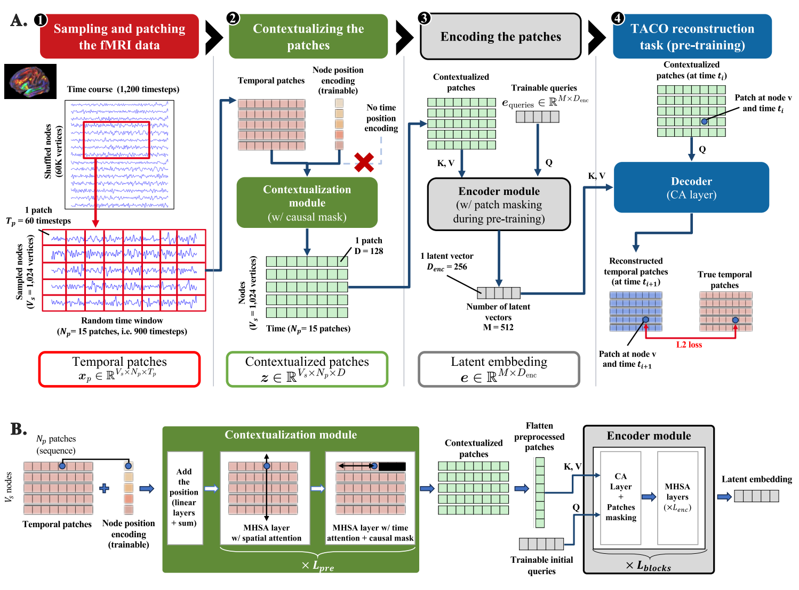

# Decoders and pretraining objectives

The decoders (paper module **D**) are the pretraining heads. They read the latent embedding and predict patches of the
signal; the loss compares each prediction with the true patch. A decoder does not reconstruct a whole recording: it
predicts **one patch at a time**, chosen by a *query*. Like the encoder, a decoder is a Perceiver IO cross-attention layer
(Jaegle et al., 2022).

Two objectives are used in the paper: the **vanilla patch reconstruction** task, and the **TACO reconstruction** task.
The first predicts a masked patch from its position in the recording; the second predicts the next patch of a channel
from the contextualized patches. The rest of this page focuses on TACO, the objective of the paper. TACO does not use a predefined time-position
embedding (sinusoidal, rotary or other): such an embedding imposes a prior on the temporal structure, which can hurt the
capture of the dynamics. The objective lets the model infer the temporal relations from the data.

## TACO: Time-Aware Conditional reconstruction

The paper's objective is TACO. For a node `v` and a patch time `i`, the query is the contextualised patch `z` of the
previous time step, and the decoder predicts the patch `x` at time `i`, conditioned on the latents `e`:

```text
x_hat(v, i) = CA(query = z(v, i-1), key/value = e)     loss = MSE(x_hat, x)  over all nodes and patch times
```

The figure below shows the task as the paper draws it: the contextualised patch at time *t_i* queries the latents and
predicts the patch at *t_(i+1)* (paper, architecture figure, panel A, stage 4).



Because the query is a contextualised patch, the prediction can use the global context of the contextualizer and the
latents, but not the patch it predicts, which the causal mask of the contextualizer keeps from the query. In the code
this is the objective `forecasting_1`: the query is a contextualised patch and the target is the patch `k` steps later.
TACO therefore needs no explicit time-position encoding. The paper's ablations show this matters: adding sinusoidal time
encodings lowers the representation quality.

## How a decoder works

A decoder is a cross-attention layer: its queries attend to the latents, and the result is projected to one patch of
`patch_length` samples. The objectives differ only in what the queries and targets are:

- **Forecasting** (`forecasting_<k>`; TACO is `forecasting_1`): query = contextualised patch, target = the patch `k`
  steps later in the same channel.
- **Reconstruction** (`reconstruction`): query = the position embeddings of the target patch, target = its raw signal.
  The paper uses this objective with time-position encodings as an ablation (configuration 1); it is not the default.

The loss is the mean squared error between predicted and target patches, weighted by `loss_weight`. Several decoders
can be combined, with one `DecoderConfig` each.

## Options

| Option | Default | Experiments | Effect |
|---|---|---|---|
| `objective` | `"forecasting_1"` | TACO | `"forecasting_<k>"` for `k >= 1`, or `"reconstruction"`. |
| `loss_weight` | 1.0 | 1.0 | Weight of this objective in the total loss. |
| `num_heads` | 1 | 1 | Attention heads of the cross-attention (single head in the paper). |
| `widening_factor` | 1 | 1 | MLP widening of the cross-attention layer. |
| `dropout` | 0.1 | 0.1 | Dropout in the decoder. |

## Reference

::: timber.modules.decoder
    options:
      members:
        - CrossAttentionDecoder
        - parse_forecast_horizon
        - forecasting_queries
        - forecasting_targets
        - reconstruction_queries
        - reconstruction_targets
