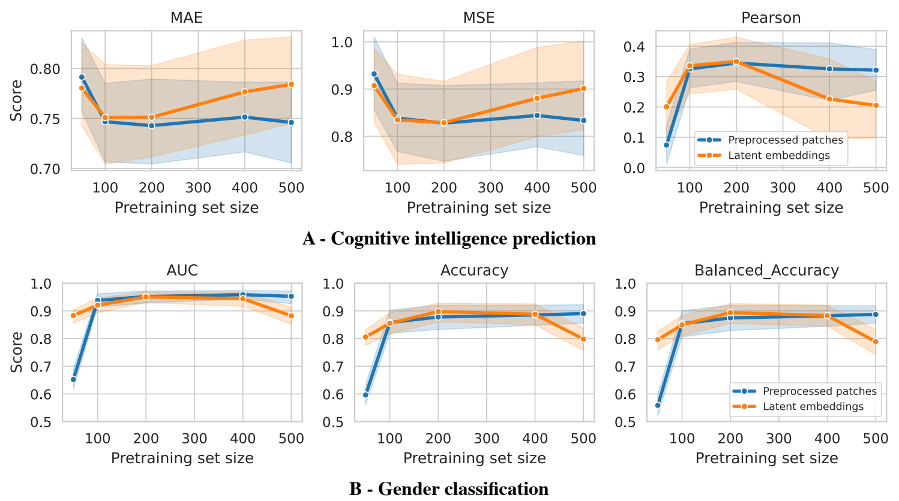
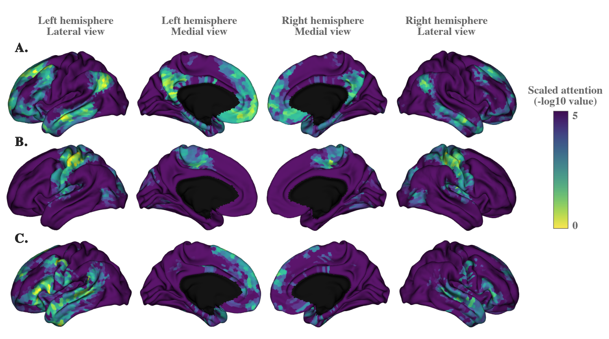
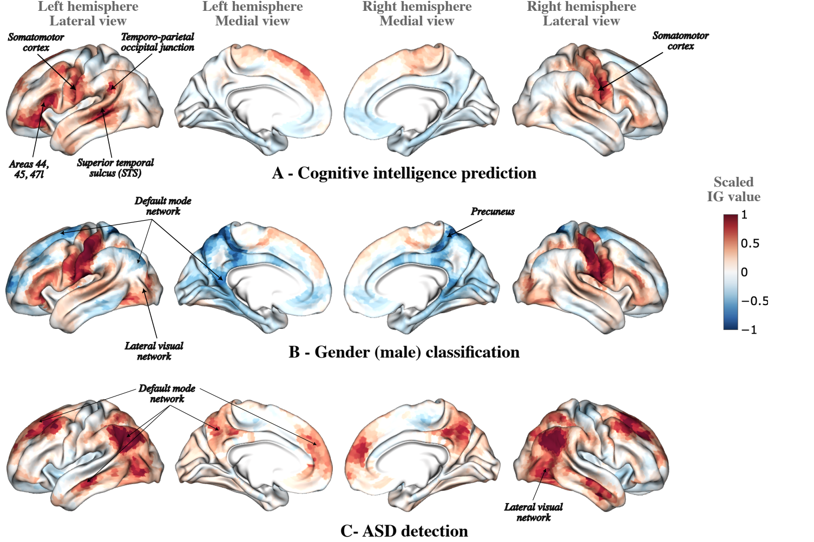

# Results

The results below are those of the paper (Le Bris, Barbano and Wassermann, under review,
[hal.science/hal-05632181](https://hal.science/hal-05632181)). The numbers are quoted, not recomputed here. The
[Paper experiments](../experiments.md) page describes how to rerun the experiments, and the paper has the full tables
and the statistical tests.

## Representations from 200 subjects

Pretrained on 200 HCP subjects (800 runs) without labels, TIMBER gives representations that are **competitive with or
better than** supervised baselines on gender classification and cognitive intelligence score prediction, whether those
baselines are trained end-to-end or fine-tuned after large-scale pretraining. Two kinds of representation are evaluated
with ridge probes:

- the **contextualised patches** `z`, averaged over the runs and pooled into the Schaefer 800-parcel atlas;
- the **latent embedding** `e` (512 latents of dimension 256), which needs no atlas.

For intelligence scores, the paper reports that TIMBER outperforms the FC-based and voxel-based baselines in MSE and
MAE, and that the patches and the latents are significantly better than the FC matrix baseline.

## Fine-tuning

Fine-tuning the encoder with an MLP head improves the latent embedding only slightly on HCP, and not to a statistically
significant degree in the paper's tests. The head is kept for interpretability: it gives the attention weights and
saliency maps used below.

## Generalisation to ABIDE I

Without any fine-tuning, the pretrained latents classify autism (ASD versus controls) with **65.0 %** accuracy in
stratified 10-fold cross-validation with site-wise and condition-wise splits. Fine-tuning raises the accuracy to
**68.9 %**. The best published ensembles reach 75.2 % on the same protocol (paper, table of the ABIDE experiment), so
TIMBER is not state of the art on this task.

## Data efficiency

*Learning curves on HCP (paper, learning-curve figure of the appendix): the training set grows from 50 to 500 subjects; test on 400 unseen subjects,
10-fold cross-validation, 95 % confidence bands.*

The patch representations plateau at about **100 training subjects**. The latent embeddings peak at **200** and then
decline: the paper attributes this to the encoder over-optimising the pretraining task as the data and the number of
steps grow, which is why fine-tuning the encoder is recommended for larger training sets.

## Ablation study

The paper removes one component at a time (configurations 1 to 5 of the [experiments](../experiments.md)), and measures the
PCC of the cognitive score prediction:

| Configuration | Latents `e` (PCC) | Patches `z` (PCC) | Reading |
|---|---|---|---|
| Full model | 0.388 | 0.378 | reference |
| 1. Standard reconstruction (no TACO) | 0.303 | 0.045 | TACO matters most for the patches |
| 2. Time-position encodings instead of causal masking | 0.199 | 0.242 | explicit time encodings hurt |
| 3. No contextualizer | 0.055 | n/a | the contextualizer is essential for the latents |
| 4. No encoder | n/a | 0.033 | the encoder is essential for the patches |
| 5. No patch masking | 0.196 | 0.175 | masking helps both |

The paper's conclusion: the contextualizer and the encoder are complementary, the TACO objective is what makes the
contextualised patches informative, and explicit time encodings are unnecessary. Values are the PCC of the cognitive score
prediction (paper, ablation table).

## Interpretability

The architecture exposes two views of what the model uses.

**Attention maps.** The cross-attention of the first encoder block shows which patches each latent reads. Three latents
of the paper attend to the default mode network, the somatomotor network and language-related regions.

*Attention of three latent queries to the contextualised patches (paper, attention figure).*

**Integrated gradients.** For each target, the paper attributes the prediction to the contextualised patches with
integrated gradients (Sundararajan et al., 2017), then averages the attributions over time and maps them to the cortex.
For cognitive intelligence the importance is concentrated in the left hemisphere, in language-related areas; the paper
also shows the maps for gender and for ASD detection.

*Integrated-gradient attribution maps for cognitive intelligence (A), gender (B) and ASD detection (C) (paper, integrated-gradient figure).*

The repository exposes what these analyses need: the attention weights of the encoder and the pooled latents of the head
(`experiments/timber_fmri/analysis.py`). The integrated-gradient maps are computed in `experiments/exploration.ipynb`, and the ridge probes in
`experiments/postprocessing.ipynb`.
